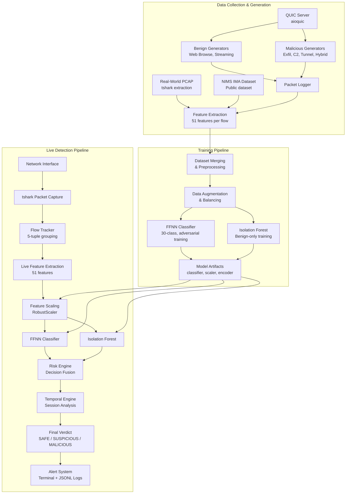
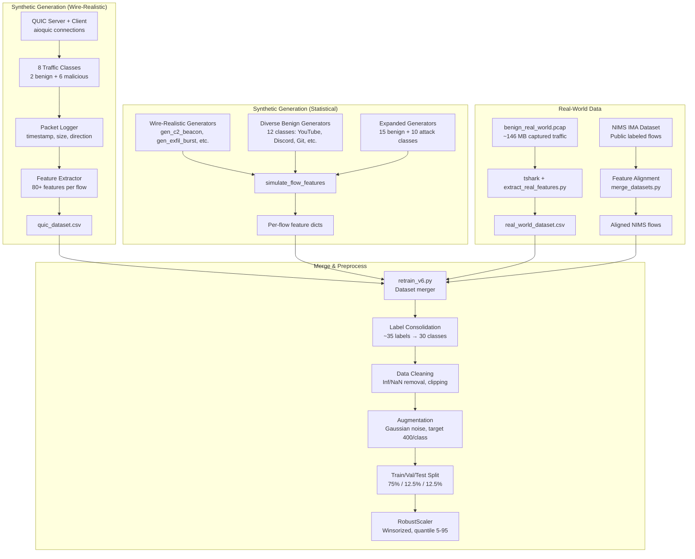
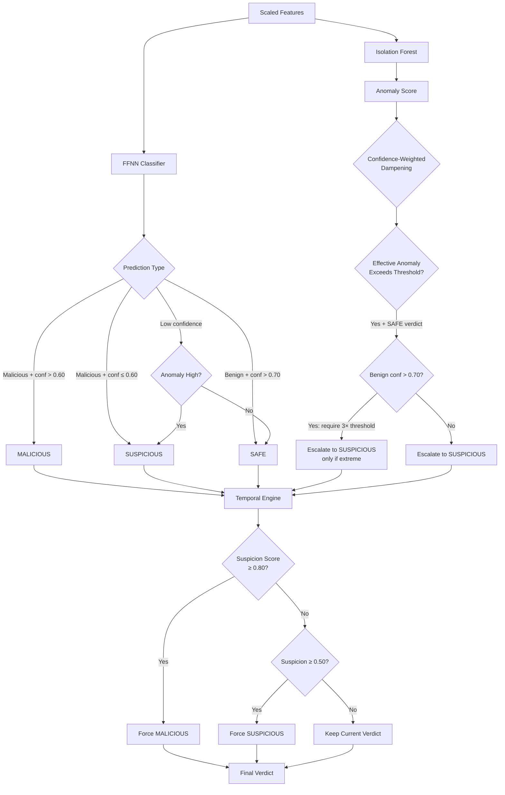

<div align="center">

# **QSentinel**

**Behavioral Intrusion Detection for Encrypted QUIC Traffic Using Machine Learning**

[](https://www.python.org/)
[](https://pytorch.org/)
[](https://scikit-learn.org/)


</div> 

QSentinel is a machine learning-based network intrusion detection system (NIDS) designed to analyze QUIC protocol traffic without relying on payload inspection. It combines a supervised feedforward neural network (FFNN) classifier with an unsupervised Isolation Forest anomaly detector, fused through a multi-signal risk engine, to classify network flows as **SAFE**, **SUSPICIOUS**, or **MALICIOUS** in real time.

---

## Table of Contents

- [Project Overview](#project-overview)
- [Problem Statement and Motivation](#problem-statement-and-motivation)
- [Key Contributions](#key-contributions)
- [System Architecture](#system-architecture)
- [Dataset Engineering Pipeline](#dataset-engineering-pipeline)
- [Attack Simulation](#attack-simulation)
- [Behavioral Feature Engineering](#behavioral-feature-engineering)
- [Machine Learning Architecture](#machine-learning-architecture)
- [Risk Engine and Decision Fusion](#risk-engine-and-decision-fusion)
- [Live Detection Pipeline](#live-detection-pipeline)
- [Training and Evaluation](#training-and-evaluation)
- [Project Structure](#project-structure)
- [Installation and Setup](#installation-and-setup)
- [Usage](#usage)
- [Model Artifacts](#model-artifacts)
- [Technologies Used](#technologies-used)
- [Current Limitations](#current-limitations)
- [Future Work](#future-work)
- [Project Information](#project-information)

---

## Project Overview

QUIC (RFC 9000) encrypts nearly all transport-layer metadata, including connection handshakes, making traditional deep packet inspection (DPI) techniques ineffective. QSentinel addresses this by extracting **behavioral features** — statistical, temporal, directional, and structural properties of network flows — that remain observable even under full encryption.

The system operates in two modes:

1. **Training mode**: Generates synthetic QUIC traffic (benign and malicious) over real QUIC connections using `aioquic`, extracts behavioral features, merges with real-world traffic datasets, and trains a dual-model detection system.
2. **Live detection mode**: Captures network packets via `tshark`, tracks flows in real time, extracts the same behavioral features, and produces per-flow security verdicts with explainable risk scores.

QSentinel is a research prototype developed as part of an academic project. It is not intended for production deployment without further validation.

---

## Problem Statement and Motivation

The adoption of QUIC and HTTP/3 across major internet services introduces fundamental challenges for network security monitoring:

- **Payload encryption**: QUIC encrypts application data and most transport headers from the first packet, eliminating visibility into request/response content.
- **Limited metadata**: Unlike TLS-over-TCP, QUIC does not expose a separate unencrypted handshake that can be passively fingerprinted in all cases.
- **Traffic classification difficulty**: Encrypted QUIC flows from a web browser, a video stream, a file upload, and a data exfiltration channel can appear structurally similar at the packet level.
- **Behavioral similarity**: Sophisticated attacks (e.g., stealth C2 beaconing, slow exfiltration) deliberately mimic legitimate traffic patterns.
- **Existing IDS limitations**: Signature-based systems and payload-dependent classifiers cannot inspect encrypted QUIC payloads, creating a detection blind spot.

QSentinel approaches this problem by analyzing **how** traffic behaves rather than **what** it contains — using packet sizes, inter-arrival times, directional patterns, burst characteristics, and Markov transition probabilities to distinguish benign from malicious flows.

---

## Key Contributions

1. **Synthetic QUIC traffic generation over real QUIC connections**: Benign and malicious traffic generators that produce labeled flows through an actual `aioquic` client-server stack, preserving realistic QUIC transport behavior.
2. **Multi-source dataset engineering**: A pipeline that merges wire-realistic synthetic data, diverse behavioral generators, expanded attack classes, real-world PCAP captures, and the NIMS IMA public dataset.
3. **51-dimensional behavioral feature vector**: A comprehensive feature set spanning statistical, timing, entropy, directional, Markovian, burst, and behavioral categories — all computable without payload access.
4. **Dual-model detection architecture**: An FFNN classifier (30-class) operating in parallel with an Isolation Forest anomaly detector trained exclusively on benign traffic.
5. **Risk-based decision fusion**: A weighted risk engine that combines classifier confidence, anomaly scores, prediction entropy, and blend detection into a unified risk score with explainable verdicts.
6. **Temporal intelligence engine**: Session-level behavioral reasoning with suspicion accumulation, beacon periodicity detection, exfiltration tracking, and progressive verdict escalation.
7. **Live network detection**: Real-time packet capture, flow tracking, feature extraction, model inference, and alert generation in a single pipeline.
8. **Adversarial robustness training**: FGSM-based adversarial training, Gaussian noise injection, and feature masking during classifier training.

---

## System Architecture

### High-Level Architecture



### Component Descriptions

| Stage | Component | Description |
|-------|-----------|-------------|
| **Capture** | `live/packet_reader.py` | Reads packets from live interfaces or PCAP files via `tshark` subprocess |
| **Flow Tracking** | `live/flow_tracker.py` | Groups packets into flows by 5-tuple, handles timeouts and max-packet limits |
| **Feature Extraction** | `live/flow_tracker.py` | Computes 51 behavioral features from accumulated packet data per flow |
| **Scaling** | `RobustScaler` | Applies the same scaling learned during training, with post-scaling clamping |
| **Classification** | `training/classifier.py` | FFNN with BatchNorm, ReLU, Dropout — outputs 30-class logits |
| **Anomaly Detection** | `training/isolation_forest.py` | Isolation Forest trained on benign data, outputs normalized anomaly scores |
| **Risk Engine** | `risk_engine.py` | Combines uncertainty, anomaly, entropy, and blend signals into a risk score |
| **Temporal Engine** | `live/temporal_engine.py` | Per-source-IP behavioral profiling with suspicion decay, beacon detection, drift |
| **Verdict Logic** | `live/inference.py` | Confidence-weighted fusion: classifier-primary, anomaly-secondary, temporal override |
| **Alerting** | `live/alert_system.py` | Color-coded terminal output with structured JSONL file logging |

---

## Dataset Engineering Pipeline

QSentinel's dataset is constructed from multiple sources to maximize behavioral diversity.

### Pipeline Overview



### Data Sources

| Source | Type | Description | Label |
|--------|------|-------------|-------|
| `run.py` → `quic_dataset.csv` | Synthetic (wire) | Real QUIC connections via aioquic | 2 benign + 6 malicious |
| `training/utils.py` generators | Synthetic (statistical) | Packet-level simulation | 3 benign + 4 malicious |
| `training/benign_generators.py` | Synthetic (statistical) | 12 diverse benign classes | YouTube, Discord, Git, Docker, etc. |
| `training/expanded_generators.py` | Synthetic (statistical) | 15 benign + 10 attack classes | Additional attack variants |
| `extract_real_features.py` | Real-world | PCAP capture processed with tshark | Benign subtypes via SNI classification |
| `NIMS_IMA_sample_data.csv` | Public dataset | NIMS IMA network flow dataset | `benign_real` |

### Label Consolidation (v6)

During training (`retrain_v6.py`), related benign labels are consolidated to reduce class fragmentation:

- All streaming variants → `benign_streaming`
- Chat/messaging variants → `benign_chat`
- Git clone/pull variants → `benign_git_download`
- Browsing variants → `benign_browsing`
- Download variants → `benign_bulk_download`
- Upload variants → `benign_upload`
- Sync variants → `benign_sync`

**Final class distribution (v6 model):** 30 classes total — 14 benign, 16 malicious.
**Total training samples after augmentation:** 12,000 (400 per class × 30 classes).

---

## Attack Simulation

QSentinel implements the following attack simulations. Wire-realistic attacks use real QUIC connections (`generators/malicious.py`); statistical attacks simulate feature distributions (`training/expanded_generators.py`).

### Wire-Realistic Attacks (via aioquic)

| Attack | Class Label | Behavior | Key Characteristics |
|--------|-------------|----------|---------------------|
| **Slow Data Exfiltration** | `malicious_exfil_slow` | Long-lived connection (15–45 s), small packets (64–512 B) at regular intervals (1–4 s) | High forward/backward byte ratio, regular IATs, low throughput |
| **Burst Data Exfiltration** | `malicious_exfil_burst` | Quiet period followed by rapid large upload (50–500 KB in small writes) | Extreme asymmetry, very low IATs during burst, high upload ratio |
| **C2 Beaconing** | `malicious_c2_beacon` | Periodic check-ins (2–8 s intervals with jitter), small request/response | High timing regularity, low size variance, periodic IAT pattern |
| **Protocol Tunneling** | `malicious_tunnel` | Bidirectional chatty traffic across multiple concurrent QUIC streams | High direction change rate, uniform packet sizes, low IAT variance |
| **Stealth C2** | `malicious_stealth_c2` | C2 communication disguised as video streaming pattern | Mimics streaming but with subtle timing and size differences |
| **Hybrid Attack** | `malicious_hybrid` | Normal browsing phase followed by sudden burst exfiltration | Phase transition detectable via burst acceleration and size trend |

### Expanded Statistical Attacks (via feature simulation)

| Attack | Class Label | Behavior |
|--------|-------------|----------|
| **Low-Rate Exfiltration** | `malicious_low_rate_exfil` | Very slow, persistent data leakage |
| **Adaptive Exfiltration** | `malicious_adaptive_exfil` | Adjusts behavior to evade detection |
| **Browser-Mimic Exfil** | `malicious_browser_mimic_exfil` | Exfiltration disguised as browsing |
| **Developer-Mimic Exfil** | `malicious_dev_mimic_exfil` | Exfiltration mimicking developer workflows |
| **Staged Exfiltration** | `malicious_staged_exfil` | Multi-phase exfiltration with staging |
| **Beacon Tunnel** | `malicious_beacon_tunnel` | Combined beaconing with tunnel |
| **Interactive Tunnel** | `malicious_interactive_tunnel` | SSH/RDP-like interactive session tunneling |
| **Cloud Abuse** | `malicious_cloud_abuse` | Abuse of cloud service patterns |
| **Multi-Phase Attack** | `malicious_multi_phase` | Complex attack with multiple behavioral phases |
| **Hybrid C2 + Exfil** | `malicious_hybrid_c2_exfil` | Combined C2 and exfiltration in single flow |

---

## Behavioral Feature Engineering

QSentinel extracts **51 numerical features** per flow, organized into 7 categories. All features are computable from packet metadata (size, timestamp, direction) without payload access.

### Feature Taxonomy

#### 1. Statistical Flow Features (15 features)

| Feature | Description |
|---------|-------------|
| `duration` | Total flow duration in seconds |
| `total_packets` | Number of packets in the flow |
| `total_bytes_fwd` | Total bytes in forward direction |
| `pkts_per_sec` | Packet rate |
| `bytes_per_sec` | Byte rate |
| `all_size_mean` | Mean packet size |
| `all_size_std` | Standard deviation of packet sizes |
| `all_size_min` | Minimum packet size |
| `all_size_max` | Maximum packet size |
| `all_size_median` | Median packet size |
| `all_size_skew` | Skewness of packet size distribution |
| `all_size_kurtosis` | Kurtosis of packet size distribution |
| `all_size_q25` | 25th percentile of packet sizes |
| `all_size_q75` | 75th percentile of packet sizes |
| `size_entropy` | Entropy of binned packet size distribution |

#### 2. Timing and Inter-Arrival Time Features (7 features)

| Feature | Description |
|---------|-------------|
| `all_iat_mean` | Mean inter-arrival time |
| `all_iat_std` | Standard deviation of IATs |
| `all_iat_min` | Minimum IAT |
| `all_iat_max` | Maximum IAT |
| `all_iat_skew` | Skewness of IAT distribution |
| `all_iat_kurtosis` | Kurtosis of IAT distribution |
| `timing_regularity` | Coefficient of variation of IATs (std/mean) |

#### 3. Directional and Ratio Features (4 features)

| Feature | Description |
|---------|-------------|
| `small_pkt_ratio` | Fraction of packets smaller than 100 bytes |
| `large_pkt_ratio` | Fraction of packets larger than 1000 bytes |
| `upload_ratio` | Ratio of forward bytes to total bytes |
| `up_down_ratio` | Forward-to-backward byte ratio |

#### 4. Markov Transition Features (4 features)

| Feature | Description |
|---------|-------------|
| `markov_fwd_fwd` | P(forward → forward) transition probability |
| `markov_fwd_bwd` | P(forward → backward) transition probability |
| `markov_bwd_fwd` | P(backward → forward) transition probability |
| `markov_bwd_bwd` | P(backward → backward) transition probability |

These capture the **sequential directionality pattern** of traffic. C2 beaconing produces high `markov_fwd_bwd` (alternating request-response), while exfiltration produces high `markov_fwd_fwd` (sustained outbound).

#### 5. Derived Tunnel and Burst Features (4 features)

| Feature | Description |
|---------|-------------|
| `iat_cv` | IAT coefficient of variation (capped at 10) |
| `size_iat_ratio` | Mean packet size / mean IAT |
| `burst_score` | IQR / median of packet sizes |
| `direction_proxy` | Product of size skewness and IAT skewness |

#### 6. Bidirectional and Exfiltration Features (5 features)

| Feature | Description |
|---------|-------------|
| `directional_entropy` | Entropy over Markov transition probabilities |
| `req_resp_cadence` | Sum of cross-direction transition probabilities |
| `alt_burst_score` | Request-response cadence × size variability |
| `fwd_bytes_per_sec` | Forward byte rate |
| `bwd_bytes_per_sec` | Backward byte rate |

#### 7. Advanced Behavioral Features (12 features)

| Feature | Description |
|---------|-------------|
| `session_asymmetry` | Mean upload/download ratio across windowed segments |
| `upload_consistency` | Variability of per-segment upload ratios |
| `beacon_periodicity` | Autocorrelation-based IAT regularity (high = periodic beaconing) |
| `temporal_volatility` | Variance of throughput across time windows |
| `burst_acceleration` | Trend of burst sizes over time (positive = escalation) |
| `interaction_density` | Average packets per direction-change episode |
| `directional_persistence` | Longest same-direction run / total packets |
| `silence_ratio` | Fraction of flow duration with no activity |
| `size_modality` | Number of modes in packet size distribution |
| `response_latency_cv` | Coefficient of variation of request→response gaps |
| `iat_trend` | Linear trend (slope) of inter-arrival times |
| `size_trend` | Linear trend (slope) of packet sizes |

**Total: 51 features** used by the v6 model. The dataset generation pipeline (`features/extractor.py`) extracts a superset of ~80 features; the training pipeline (`training/utils.py`) selects the 51 features listed above as `ALL_FEATURES`.

---

## Machine Learning Architecture

### FFNN Classifier

The primary detection model is a feedforward neural network implemented in `training/classifier.py`.

| Property | Value |
|----------|-------|
| **Architecture** | Input(51) → Linear(256) → BN → ReLU → Dropout(0.45) → Linear(128) → BN → ReLU → Dropout(0.45) → Linear(64) → BN → ReLU → Dropout(0.45) → Linear(30) |
| **Input** | 51-dimensional scaled feature vector |
| **Output** | 30-class logits (14 benign + 16 malicious) |
| **Activation** | ReLU (hidden), raw logits output (softmax applied externally) |
| **Normalization** | BatchNorm1d after each linear layer |
| **Regularization** | Dropout (0.45), weight decay (8×10⁻⁴), label smoothing (0.05) |
| **Weight Init** | Kaiming Normal |
| **Optimizer** | AdamW (lr=1×10⁻³, weight decay=8×10⁻⁴) |
| **Scheduler** | CosineAnnealingLR (T_max=150, eta_min=1×10⁻⁶) |
| **Loss** | CrossEntropyLoss with label smoothing = 0.05 |
| **Training** | Up to 150 epochs, early stopping (patience=30) |
| **Adversarial Training** | FGSM + Gaussian noise + feature masking (activated after epoch 20) |
| **Calibration** | Post-hoc temperature scaling on validation set (LBFGS optimization) |

### Isolation Forest Anomaly Detector

The secondary model is an Isolation Forest trained exclusively on benign traffic, implemented in `training/isolation_forest.py`.

| Property | Value |
|----------|-------|
| **Implementation** | scikit-learn `IsolationForest` wrapper |
| **Trees** | 200 estimators |
| **Contamination** | 0.01 (1% expected anomalies in benign data) |
| **Max Features** | 0.8 (80% feature subsampling per tree) |
| **Training Data** | Benign-only scaled feature vectors from the training set |
| **Scoring** | Z-score normalized, then scaled: `(raw - mean) / std × 5 + 5` |
| **Threshold** | 97th percentile of validation benign scores (v6: ~10.82) |

The Isolation Forest provides a **payload-independent anomaly signal** — it detects traffic that is structurally unusual compared to learned benign patterns, regardless of which class the classifier predicts.

### Model Interaction

Both models operate **in parallel** on the same scaled input:
1. The FFNN produces class probabilities and a predicted class.
2. The Isolation Forest produces an anomaly score.
3. Both signals are fused by the Risk Engine into a single verdict.

The classifier is the **primary decision maker**. The Isolation Forest is a **secondary escalation signal** — it can escalate a SAFE verdict to SUSPICIOUS but cannot unilaterally declare MALICIOUS.

---

## Risk Engine and Decision Fusion

The `RiskScoringEngine` (in `risk_engine.py`) computes a composite risk score from four weighted signals:

```
risk_score = 0.40 × uncertainty + 0.25 × norm_anomaly + 0.10 × blend_score + 0.25 × norm_entropy
```

| Component | Weight | Computation |
|-----------|--------|-------------|
| **Uncertainty** | 0.40 | `1 - classifier_confidence` |
| **Normalized Anomaly** | 0.25 | `anomaly_score / (2 × threshold)`, clamped to [0, 1] |
| **Blend Score** | 0.10 | Detects ambiguous predictions with moderate confidence and elevated anomaly |
| **Prediction Entropy** | 0.25 | Normalized Shannon entropy of class probability distribution |

### Risk Levels

| Risk Score | Risk Level |
|------------|------------|
| < 0.30 | LOW |
| 0.30 – 0.55 | MEDIUM |
| 0.55 – 0.80 | HIGH |
| ≥ 0.80 | CRITICAL |

### Verdict Decision Flow



### Key Design Decisions

1. **Confidence-weighted anomaly dampening**: High-confidence benign predictions (>0.70) suppress the anomaly signal by up to 90%. This prevents the Isolation Forest from overriding confident classifier decisions — the single largest source of false positives in earlier versions.
2. **Malicious prediction floor**: A flow classified as malicious (regardless of confidence) can never receive a SAFE verdict.
3. **Temporal escalation**: The `TemporalIntelligenceEngine` tracks per-source-IP suspicion scores with exponential decay (5-minute half-life). Sustained suspicious activity from the same source can escalate verdicts to MALICIOUS.
4. **Beacon detection**: Autocorrelation-based periodicity detection identifies C2-like communication patterns across multiple flows from the same source.

---

## Live Detection Pipeline

### Execution Flow

1. **Packet Capture** (`live/packet_reader.py`): Launches `tshark` as a subprocess, reads packets as pipe-delimited text fields (timestamp, IPs, ports, length, protocol).
2. **Flow Tracking** (`live/flow_tracker.py`): Groups packets into flows by 5-tuple. Flows complete on timeout (default: 30 s) or max packets (2000). Minimum 10 packets required.
3. **Feature Extraction** (`live/flow_tracker.py:extract_features`): Computes all 51 features from the accumulated packet data.
4. **Inference** (`live/inference.py`):
   - Clips and sanitizes raw features
   - Applies the saved `RobustScaler`
   - Post-scaling safety clamp (±6.0)
   - Delegates to `RiskBasedIDS.analyze_single()`
   - Applies confidence-weighted anomaly dampening
   - Applies temporal intelligence context
   - Produces final `FlowVerdict`
5. **Alerting** (`live/alert_system.py`): Displays color-coded alerts in terminal, writes structured JSONL log entries.

### Supported Modes

| Mode | Command | Description |
|------|---------|-------------|
| **Live Capture** | `python detect.py --live -i eth0` | Real-time monitoring via tshark |
| **PCAP Analysis** | `python detect.py --pcap capture.pcap` | Offline analysis of captured traffic |
| **Simulation** | `python detect.py --simulate 50` | Test with synthetic flows (no tshark needed) |

---

## Training and Evaluation

### Training Process (`retrain_v6.py`)

1. **Data generation**: Produces flows from all generator sources (wire-realistic, diverse benign, expanded).
2. **Data loading**: Loads existing synthetic dataset, NIMS IMA data, and real-world features.
3. **Merging**: Concatenates all sources on shared feature columns.
4. **Label consolidation**: Maps ~35 benign labels to 14 behavioral groups.
5. **Augmentation**: Gaussian noise augmentation to 400 samples per class.
6. **Splitting**: 75% train, 12.5% validation, 12.5% test (stratified).
7. **Scaling**: RobustScaler with winsorization (1st–99th percentile) and post-scaling clamp (±5.0).
8. **Classifier training**: 150 epochs max, adversarial training after epoch 20, cosine annealing LR.
9. **Temperature calibration**: Post-hoc LBFGS optimization on validation logits.
10. **Isolation Forest training**: Fitted on scaled benign training data only.
11. **Threshold calibration**: 97th percentile of Isolation Forest scores on validation benign data.
12. **Evaluation**: Classification report on held-out test set.

### Verified Results (v6 Model)

The following metrics are from the v6 training run, as recorded in `models_v6/training_summary_v5.json`:

| Metric | Value | Source |
|--------|-------|--------|
| **Test Accuracy** | 97.67% | Held-out test set (12.5% of augmented data) |
| **Number of Classes** | 30 | 14 benign + 16 malicious |
| **Benign Misclassified as Malicious** | 17 | Out of total benign test samples |
| **Anomaly Threshold (IForest)** | 10.82 | 97th percentile of validation benign scores |
| **Calibration Temperature** | 0.839 | LBFGS-optimized on validation set |
| **ECE (before calibration)** | 0.0259 | Expected Calibration Error |
| **ECE (after calibration)** | 0.0149 | 42% improvement |
| **Total Training Samples** | 12,000 | After augmentation (400 × 30 classes) |

> **Note**: These metrics are from the training/validation/test split of the augmented dataset, which includes both synthetic and real-world data. Performance on purely real-world traffic may differ. See [Current Limitations](#current-limitations).

---

## Project Structure

```
QSentinel/
├── README.md                          # This file
├── requirements.txt                   # Python dependencies
├── config.py                          # Server config, traffic type constants, label map
├── run.py                             # Dataset generation entry point (wire-realistic)
├── detect.py                          # Live detection entry point
├── retrain_v6.py                      # Model training script (v6)
├── server.py                          # QUIC server for dataset generation
├── protocol.py                        # Instrumented QUIC protocol (packet logging)
├── packet_logger.py                   # Thread-safe packet recording
├── generate_certs.py                  # Self-signed TLS certificate generator
├── risk_engine.py                     # Risk scoring, feature explanation, temporal tracking
├── merge_datasets.py                  # Merge synthetic + NIMS datasets
├── extract_real_features.py           # Extract features from real-world PCAP files
├── demo_malicious.py                  # Malicious traffic simulator for IDS testing
├── adversarial_eval.py                # Adversarial robustness evaluation framework
├── NIMS_IMA_sample_data.csv           # Public NIMS IMA dataset sample
│
├── generators/                        # Wire-realistic QUIC traffic generators
│   ├── __init__.py                    # Exports ALL_GENERATORS list
│   ├── base.py                        # BaseGenerator: QUIC connection + logging
│   ├── benign.py                      # WebBrowsingGenerator, StreamingGenerator
│   └── malicious.py                   # SlowExfil, BurstExfil, C2, Tunnel, Stealth, Hybrid
│
├── features/                          # Feature extraction for dataset generation
│   ├── __init__.py
│   └── extractor.py                   # FeatureExtractor: 80+ features, CSV/Parquet export
│
├── training/                          # ML training modules
│   ├── __init__.py
│   ├── classifier.py                  # QUICClassifier (FFNN architecture)
│   ├── isolation_forest.py            # QUICIsolationForest wrapper
│   ├── trainer.py                     # ClassifierTrainer with early stopping
│   ├── evaluate.py                    # Evaluator: confusion matrix, FPR, anomaly analysis
│   ├── data_pipeline.py               # DataPipeline: load → split → scale → DataLoader
│   ├── adversarial.py                 # FGSM, PGD, noise, adversarial training step
│   ├── augment.py                     # Gaussian, scaling, interpolation augmentation
│   ├── calibration.py                 # Temperature scaling, ECE computation
│   ├── ensemble.py                    # EnsembleDecisionSystem (classifier + IForest fusion)
│   ├── utils.py                       # Feature constants, simulate_flow_features, generators
│   ├── benign_generators.py           # 12 diverse benign traffic generators
│   └── expanded_generators.py         # 15 expanded benign + 10 expanded attack generators
│
├── live/                              # Live detection modules
│   ├── __init__.py
│   ├── packet_reader.py               # tshark integration, PCAP reading, simulation
│   ├── flow_tracker.py                # FlowTracker, feature extraction, flow completion
│   ├── inference.py                   # InferenceEngine: model loading, verdict generation
│   ├── alert_system.py                # Terminal display + JSONL logging
│   ├── alert_manager.py               # Alert aggregation and fatigue reduction
│   └── temporal_engine.py             # Session-level behavioral reasoning engine
│
├── models_v6/                         # Trained model artifacts (v6 — current)
│   ├── classifier_v5.pt              # FFNN weights + metadata
│   ├── iforest_v5.joblib             # Serialized Isolation Forest
│   ├── scaler_v5.joblib              # Fitted RobustScaler
│   ├── label_encoder_v5.joblib       # Fitted LabelEncoder
│   └── training_summary_v5.json      # Training metrics and configuration
│
├── models_v5/                         # Previous model artifacts (v5)
│   └── ...                            # Same structure as models_v6
│
├── validation_results/                # Evaluation and validation reports
│   ├── validation_results.json
│   ├── calibration_report.json
│   ├── false_positive_report.json
│   ├── explainability_report.json
│   └── ...
│
├── certs/                             # Generated TLS certificates (for dataset generation)
│   ├── cert.pem
│   └── key.pem
│
└── output/                            # Generated datasets (not committed)
    ├── quic_dataset.csv
    ├── quic_dataset.parquet
    ├── real_world_dataset.csv
    └── ...

```

---

## Installation and Setup

### Prerequisites

- **Python**: 3.10 or later
- **Operating System**: Linux recommended (tshark integration, raw packet capture)
- **tshark**: Required for live capture and PCAP analysis (`sudo apt install wireshark-cli` or `tshark`)
- **Root/sudo**: Required for live network capture on most interfaces

### Installation

```sh
# Clone the repository
git clone https://github.com/Detox-coder/QSentinel.git
cd QSentinel

# Create and activate virtual environment
python3 -m venv .venv
source .venv/bin/activate

# Install dependencies
pip install -r requirements.txt
```

### Verify Installation

```sh
# Test with simulated flows (no tshark or models needed for generation)
python run.py --flows-per-class 5

# Test detection with simulation (requires trained models in models_v6/)
python detect.py --simulate 20
```

---

## Usage

### 1. Generate Synthetic Dataset

```sh
# Generate 50 flows per class (default: 8 classes × 50 = 400 flows)
python run.py

# Generate 200 flows per class
python run.py --flows-per-class 200

# Generate specific classes only
python run.py --classes benign_web malicious_c2_beacon

# Custom output prefix
python run.py --flows-per-class 100 --output-prefix my_dataset
```

Output is saved to `output/quic_dataset.csv` and `output/quic_dataset.parquet`.

### 2. Extract Features from Real-World PCAP

```sh
# Extract features from a PCAP file (requires tshark)
python extract_real_features.py --pcap path/to/capture.pcap

# Custom settings
python extract_real_features.py --pcap capture.pcap --timeout 120 --min-packets 20
```

### 3. Train Models

```sh
# Train v6 models (FFNN + Isolation Forest)
python retrain_v6.py
```

This reads from `output/quic_dataset.csv`, `NIMS_IMA_sample_data.csv`, and `output/real_world_dataset.csv`, and saves model artifacts to `models_v6/`.

### 4. Live Detection

```sh
# Live capture on default interface (requires root/sudo)
sudo python detect.py --live

# Specific interface
sudo python detect.py --live -i eth0

# Analyze a PCAP file
python detect.py --pcap path/to/traffic.pcap

# Simulated flows (no tshark or root needed)
python detect.py --simulate 50

# Verbose mode (show SAFE flows too)
python detect.py --live --verbose

# Use specific model directory
python detect.py --live --models-dir models_v6

# Disable QUIC-only filter
python detect.py --live --no-quic-filter

# Debug ML outputs
python detect.py --simulate 20 --debug-ml
```

### 5. Attack Simulation (for IDS Testing)

```sh
# Run the malicious traffic simulator (in one terminal)
python demo_malicious.py

# Run detection simultaneously (in another terminal)
sudo python detect.py --live --no-quic-filter
```

---

## Model Artifacts

The following files in `models_v6/` are required for inference:

| File | Size | Purpose | Generated By |
|------|------|---------|-------------|
| `classifier_v5.pt` | ~240 KB | FFNN weights, architecture config, feature list, temperature, anomaly threshold | `retrain_v6.py` |
| `iforest_v5.joblib` | ~2.7 MB | Serialized Isolation Forest model | `retrain_v6.py` |
| `scaler_v5.joblib` | ~4 KB | Fitted RobustScaler parameters | `retrain_v6.py` |
| `label_encoder_v5.joblib` | ~4 KB | Class name ↔ integer mapping | `retrain_v6.py` |
| `training_summary_v5.json` | ~2 KB | Training metrics, class list, hyperparameters | `retrain_v6.py` |

> **Note**: The filenames use the `_v5` suffix for historical compatibility. The `models_v6/` directory contains the latest (v6) trained versions of these artifacts.

**Artifact handling for GitHub**:
- The total model directory is approximately **3 MB**, which is within GitHub's file size limits.
- These artifacts can be committed directly to the repository or distributed via GitHub Releases.
- To regenerate from scratch, run `python retrain_v6.py` (requires the training datasets).

---

## Technologies Used

| Technology | Version | Purpose |
|------------|---------|---------|
| [Python](https://www.python.org/) | 3.10+ | Primary language |
| [PyTorch](https://pytorch.org/) | ≥ 2.0 | FFNN classifier training and inference |
| [scikit-learn](https://scikit-learn.org/) | ≥ 1.4 | Isolation Forest, RobustScaler, LabelEncoder, metrics |
| [NumPy](https://numpy.org/) | ≥ 1.26 | Numerical computation, feature extraction |
| [Pandas](https://pandas.pydata.org/) | ≥ 2.2 | Dataset manipulation and export |
| [SciPy](https://scipy.org/) | ≥ 1.12 | Statistical functions (skewness, kurtosis, linear regression) |
| [aioquic](https://github.com/aiortc/aioquic) | ≥ 1.2 | QUIC protocol implementation for traffic generation |
| [cryptography](https://cryptography.io/) | ≥ 42.0 | TLS certificate generation |
| [PyArrow](https://arrow.apache.org/docs/python/) | ≥ 15.0 | Parquet file I/O |
| [joblib](https://joblib.readthedocs.io/) | ≥ 1.3 | Model serialization |
| [Matplotlib](https://matplotlib.org/) | ≥ 3.8 | Visualization (training) |
| [Seaborn](https://seaborn.pydata.org/) | ≥ 0.13 | Statistical visualization |
| [tshark](https://www.wireshark.org/) | System | Packet capture and PCAP parsing (external dependency) |

---

## Current Limitations

1. **Synthetic-to-real domain gap**: The majority of training data is synthetically generated. While real-world PCAP data and the NIMS dataset are included, the model's performance on diverse production networks has not been extensively validated.

2. **Limited attack diversity**: The malicious traffic classes are simulated based on known behavioral patterns. Novel or zero-day attacks with previously unseen behavioral signatures may not be detected.

3. **QUIC version coverage**: Traffic generation uses `aioquic`, which implements specific QUIC versions. Behavior of other QUIC implementations (e.g., Google's QUICHE, Cloudflare's quiche) may differ in observable metadata.

4. **Single-host evaluation**: Live detection has been primarily tested on loopback and local network interfaces. Large-scale deployment on high-throughput links has not been benchmarked.

5. **False positive challenges**: Despite confidence-weighted anomaly dampening and temporal intelligence, false positives remain possible, particularly for:
   - Unusual but legitimate traffic patterns not represented in training
   - Application behaviors that coincidentally resemble attack signatures
   - Mixed traffic on the same flow (e.g., multiplex QUIC streams)

6. **tshark dependency**: Live detection relies on `tshark` for packet capture and QUIC dissection. This introduces a dependency on Wireshark's QUIC parser and its update cycle.

7. **Feature extraction latency**: Flows must accumulate a minimum number of packets (default: 10) before feature extraction, introducing detection latency for short-lived flows.

8. **No encrypted payload fingerprinting**: QSentinel does not attempt TLS/QUIC fingerprinting (e.g., JA3/JA4). It relies entirely on behavioral features.

9. **Calibration scope**: Temperature calibration is performed on the same data distribution as training. Out-of-distribution inputs may still produce overconfident predictions.

10. **Research prototype**: QSentinel is a research project, not a production-hardened security tool. It has not undergone security auditing, adversarial red-teaming beyond FGSM, or regulatory compliance review.

---

## Future Work

- **Broader real-world datasets**: Integration of large-scale QUIC traffic captures from diverse networks, ISPs, and geographic regions to reduce the synthetic-to-real domain gap.
- **Improved attack simulation**: Modeling more sophisticated evasion techniques including traffic shaping, mimicry, and adaptive behavior.
- **Cross-implementation validation**: Testing with traffic from multiple QUIC stacks (Chromium, Firefox, Cloudflare, etc.) to verify generalization.
- **Reduced false positives**: Continued refinement of the confidence-weighted fusion model and temporal intelligence thresholds based on extended live evaluation.
- **Incremental/online learning**: Adapting the model to new traffic patterns without full retraining.
- **Extended temporal analysis**: Multi-flow correlation and long-term behavioral profiling for detecting slow, distributed attacks.
- **QUIC-specific features**: Exploiting QUIC-specific observable metadata (connection ID rotation patterns, packet number gaps, ACK frame timing) as additional features.
- **Performance optimization**: Profiling and optimizing the inference pipeline for high-throughput deployment scenarios.

---

## Project Information

**Project:** QSentinel — Behavioral Intrusion Detection for Encrypted QUIC Traffic

**Developer:** Amit Mondal

**Project Mentor:** Mrs. Mrittika Chakraborty

**Department:** Department of Computer Science and Engineering

**Institution:** University of Kalyani, West Bengal, India

---

### Acknowledgement

This project was developed under the guidance of Mrs. Mrittika Chakraborty, whose mentorship and direction were instrumental throughout the research and development process. Her expertise and feedback shaped the technical approach and evaluation methodology of QSentinel.

---